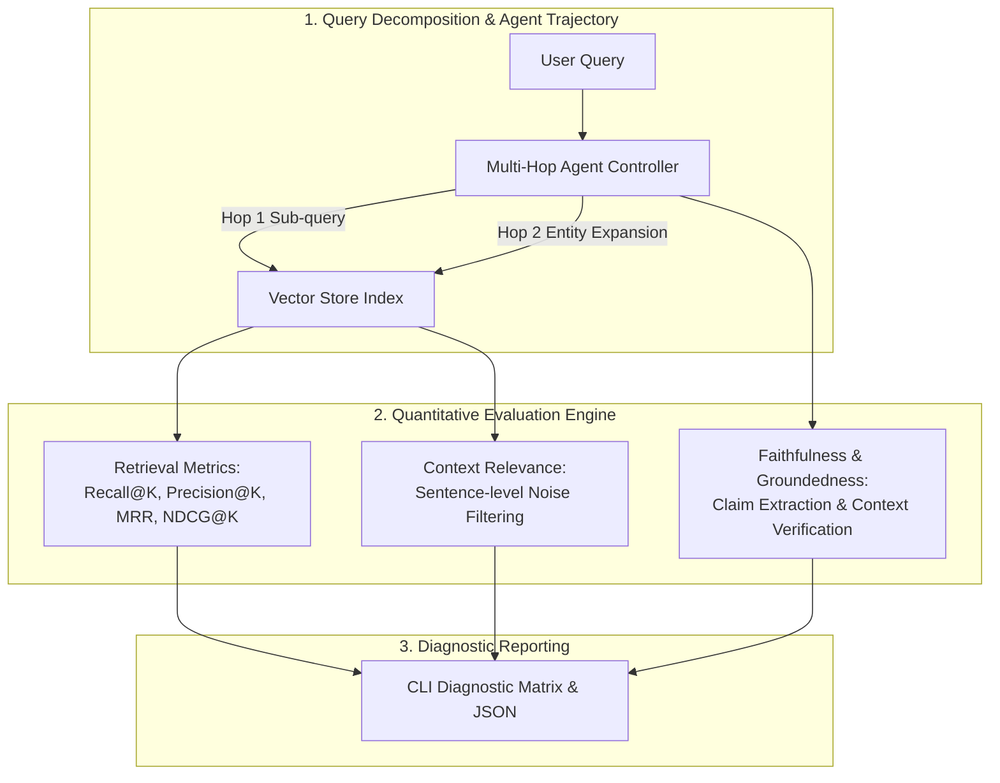

# agentic-rag-benchmark

[](https://github.com/GuptaSoujanya/agentic-rag-benchmark/actions)
[](https://opensource.org/licenses/Apache-2.0)
[](https://www.python.org/downloads/)

An evaluation and diagnostic toolkit measuring retrieval precision, context recall, hallucination rates, and multi-step reasoning accuracy in Agentic Retrieval-Augmented Generation (RAG) pipelines.

---

## Architectural Topology



---

## Core Capabilities

- **Retrieval Metrics Suite:** Implements unbiased NDCG@K, MRR (Mean Reciprocal Rank), Precision@K, and Recall@K.
- **Atomic Claim Faithfulness Evaluator:** Parses model outputs into constituent claims and verifies ground truth entailment to catch subtle hallucinations.
- **Agentic Trajectory Tracker:** Evaluates multi-hop query refinement across successive retrieval steps.
- **Zero-Dependency Lightweight Core:** Runs standalone without heavy external vector database servers or API keys.

---

## Installation

```bash
git clone https://github.com/GuptaSoujanya/agentic-rag-benchmark.git
cd agentic-rag-benchmark
pip install -e .
```

---

## Quickstart

Run evaluation on the multi-hop evaluation set:

```bash
python -m rag_bench.cli --data data/multihop_bench.json --top-k 2
```

Sample output:
```text
========================================================
        AGENTIC RAG EVALUATION REPORT
========================================================
 Evaluated Queries       : 2
 Retrieval Recall@2    : 100.00%
 Retrieval Precision@2 : 75.00%
 Mean Reciprocal Rank    : 1.0000
 NDCG@2                : 0.9197
 Faithfulness Score      : 100.00%
 Context Relevance Score : 66.67%
========================================================
```

---

## Running Test Suite

```bash
python -m unittest discover tests -v
```

---

## License

This project is licensed under the Apache 2.0 License - see the [LICENSE](LICENSE) file for details.
