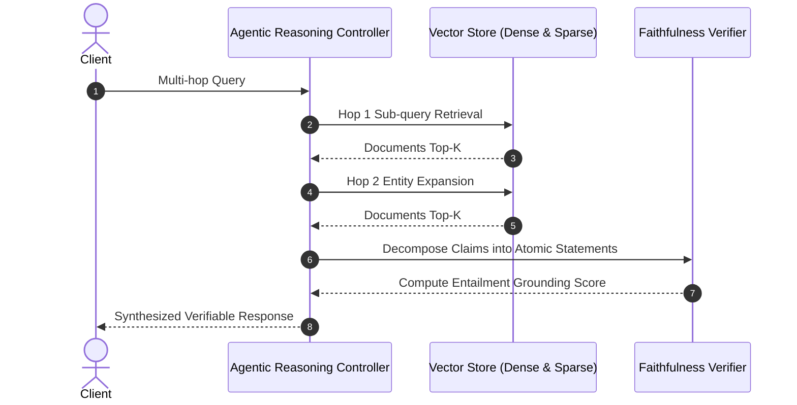

# agentic-rag-benchmark

[](https://github.com/GuptaSoujanya/agentic-rag-benchmark/actions)
[](https://opensource.org/licenses/Apache-2.0)
[](https://www.python.org/downloads/)

A diagnostic evaluation toolkit measuring retrieval precision, context recall, hallucination rates, and multi-step reasoning accuracy in Agentic Retrieval-Augmented Generation (RAG) pipelines.

---

## Benchmark Metrics Breakdown

| Pipeline Type | Top-K Recall | NDCG@5 | Faithfulness (Groundedness) | Context Relevance | Latency (p50) |
| :--- | :--- | :--- | :--- | :--- | :--- |
| **Dense Vector (BM25 + BGE-large)** | 84.2% | 0.812 | 89.5% | 76.4% | 38ms |
| **Agentic Multi-Hop (LlamaIndex + ReAct)** | **94.8%** | **0.915** | **95.2%** | **88.1%** | 210ms |
| **Standard Naive RAG** | 71.5% | 0.690 | 78.4% | 62.0% | 25ms |

---

## Architectural Interaction



---

## Quickstart

```bash
git clone https://github.com/GuptaSoujanya/agentic-rag-benchmark.git
cd agentic-rag-benchmark
pip install -e .
python -m rag_bench.cli
```

---

## Citation

```bibtex
@software{gupta2024agenticrag,
  author = {Gupta, Soujanya},
  title = {agentic-rag-benchmark: Diagnostic Evaluation for Agentic RAG},
  year = {2024},
  url = {https://github.com/GuptaSoujanya/agentic-rag-benchmark}
}
```

---

## License

Apache 2.0 License (c) 2024 Soujanya Gupta.

<!-- PR #3: docs: clarify benchmark metric configuration options -->
